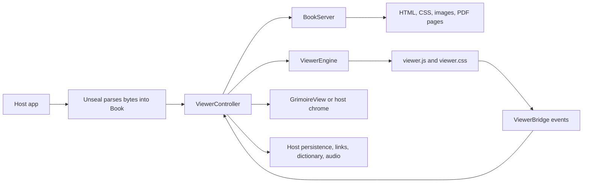

# Understand the Grimoire codebase

Grimoire turns an Unseal `Book` into an interactive Flutter reader. This guide
maps each reader capability to its public contract, implementation, tests, and
consumer documentation. Read [the architecture guide](architecture.md) for
dependency boundaries and runtime flows. Read [the README](../README.md) for
installation, host configuration, supported formats, and usage.

Paths below are relative to `lib/` unless they begin with `assets/`, `test/`,
or `example/`. Only `grimoire.dart` is a supported consumer import. Files under
`src/` remain implementation details unless that facade exports their types.

## The whole reader in one picture

Unseal owns parsing, metadata, canonical text, locators, and annotation wire
types. Grimoire owns presentation and interaction. The host owns persistence,
external actions, and playback. `grimoire_narration` is a downstream package.

## Feature map

| Capability | Public contract | Main implementation | Contract tests | Consumer docs |
| --- | --- | --- | --- | --- |
| Open supported books | `Unseal`, `Book`, `GrimoireView`, `ViewerController` | `controller/viewer_controller.dart`, `features/serving/` | `format_viewer_integration_test.dart`, `book_content_test.dart` | README: formats, usage; architecture: open flow |
| Native and web rendering | `ViewerEngine`, `ViewerEngineFactory` | `features/rendering/api/`, `adapters/`, `composition/` | `rendering_engines_test.dart`, `viewer_ready_test.dart` | README: platforms and host requirements |
| Off-screen page and cover capture | `GrimoirePageRenderer`, `PageRenderTarget` | `features/rendering/api/page_render.dart`, capture adapters | `page_render_test.dart`, `inapp_headless_page_capture_test.dart` | README: rendering pages off-screen |
| Book serving and script policy | `BookJavaScriptPolicy` | `features/serving/`, `assets/viewer/` | `book_server_test.dart`, `book_javascript_policy_test.dart` | README: JavaScript policy; architecture: serving |
| Pagination, scrolling, chapter preload | `ViewerLayoutMode`, controller navigation methods | `controller/`, `assets/viewer/viewer.js` | `pagination_math_test.dart`, `navigation_coordinator_test.dart`, `viewer_controller_test.dart` | README: usage, how it works |
| Positions, TOC, history, progress and time | `ViewerPosition`, `ViewerPageChange`, `ReadingSessionEvent` | `features/navigation/`, `controller/` | `viewer_position_test.dart`, `viewer_features_test.dart`, `reader_shell_chrome_test.dart` | README: controller example |
| In-book search and result navigation | `SearchMode`, `ViewerSearchResult`, controller search methods | `features/search/`, `widgets/search_overlay*` | `public_search_contract_test.dart`, `viewer_features_test.dart` | README: controller example |
| Selection, highlights and bookmarks | Unseal annotation types, `ViewerSelection`, controller annotation methods | `features/annotations/`, bridge, selection toolbar | `annotation_controller_test.dart`, `annotation_query_test.dart`, `viewer_features_test.dart` | README: controller example |
| Annotation filtering and export | `AnnotationQuery`, `ViewerExportModel`, `ViewerExportRendering` | `features/annotations/` | `export_test.dart`, `annotations_sheet_test.dart` | README: exporting annotations |
| Appearance, profiles, RTL and accessibility | `ViewerTheme`, `ViewerMargins`, settings methods | `features/settings/`, `widgets/`, viewer assets | `viewer_theme_test.dart`, `value_types_gaps_test.dart`, `reader_shell_chrome_test.dart` | README: controller example |
| PDF reflow, facsimile and passwords | `PdfReadingMode`, `PdfPasswordRequestEvent`, controller PDF hooks | `features/pdf/`, `features/pdfjs/`, serving, viewer assets | `real_pdf_integration_test.dart`, `pdf_password_test.dart`, `pdfjs_loader_test.dart` | README: PDF usage |
| Fixed-layout EPUB pages | `ViewerController.isFixedLayoutEpub`, `isFixedLayoutPage` | `features/serving/fixed_layout.dart`, `book_html_pipeline.dart`, `assets/viewer/`, `controller/` | `fixed_layout_test.dart` | README: fixed-layout EPUB |
| MathJax loading | `MathJaxLoader` | `features/mathjax/`, serving | `mathjax_loader_test.dart` | README: optional assets |
| Narration-facing text and marks | `segmentText`, `TextSegment`, controller narration marks | `features/narration/`, bridge, viewer assets | `narration_segmentation_test.dart` | README: narration hooks |
| Built-in chrome and host hooks | `GrimoireView`, `ViewerController`, events | `widgets/`, bridge | `grimoire_view_hooks_test.dart`, `reader_shell_chrome_test.dart` | README: usage and host ownership |

The format table in the README describes viewer behavior, not a second parser.
Format parsing tests and parser limits belong to Unseal. The integration suite
here proves that representative Unseal books enter the common serving and
reader path. It does not claim exhaustive rendering parity on every device.

## Start at the public facade

| File | Responsibility |
| --- | --- |
| `grimoire.dart` | Re-exports selected Unseal contracts and Grimoire's supported widgets, controller, events, settings, export types, and extension points. Check it before changing consumer compatibility. |

## Controller and navigation

| File | Responsibility |
| --- | --- |
| `src/controller/viewer_controller.dart` | Owns a book session, two engines, lifecycle, settings, navigation, search, annotations, PDF mode, host events, and disposal. It is the main state owner. |
| `src/controller/navigation_coordinator.dart` | Resolves explicit jumps, chapter boundaries, history, and readiness into engine navigation. |
| `src/controller/navigation_host.dart` | Interface used by the coordinator to ask the controller to load or change position. |
| `src/controller/navigation_intent.dart` | Typed destination for a requested jump. |
| `src/controller/navigation_ready_state.dart` | Readiness state that prevents navigation before the active page can accept it. |
| `src/controller/page_measurement_controller.dart` | Tracks page counts and layout measurements across files. |
| `src/features/navigation/page_estimation.dart` | Computes reader-facing estimates when exact layout measurements are unavailable. |
| `src/features/navigation/viewer_events.dart` | Values emitted for page changes and reading sessions. |
| `src/features/navigation/viewer_position.dart` | Reader position with Unseal's canonical locator. |

The bridge reports a page position in the current document. The controller
maps it to a reading-order index and Unseal `TextLocator`; navigation and
annotations must use that same character space. The host persists the locator
through Unseal's `locatorToJson` and `locatorFromJson`.

## Serving and page security

| File | Responsibility |
| --- | --- |
| `src/features/serving/book_server.dart` | Conditional entry point for the platform server. |
| `src/features/serving/book_server_io.dart` | Native loopback HTTP server and resource responses, including byte ranges for media. |
| `src/features/serving/book_server_web.dart` | Browser-side same-origin resource serving through blob URLs. |
| `src/features/serving/book_content.dart` | Book-content contract presented to the server. |
| `src/features/serving/book_javascript_policy.dart` | Explicit disabled/trusted-book script policy. |
| `src/features/serving/book_html_pipeline.dart` | Rewrites book HTML, applies the selected script policy, and injects Grimoire assets. |
| `src/features/serving/book_resource_resolution.dart` | Resolves and classifies book resource paths. |
| `src/features/serving/synthetic_pages.dart` | Builds HTML for image-first or facsimile reading items. |
| `src/features/serving/fixed_layout.dart` | Derives per-file fixed-page presentation (declared viewports) from an EPUB 3 book's rendition settings. |
| `assets/viewer/viewer.js` | Measures pages, manages input and selection, and communicates with the Dart bridge. |
| `assets/viewer/viewer.css` | Reader layout and appearance rules. |

Keep the default script policy for arbitrary books. The opt-in mode lets the
host run book-authored JavaScript; it does not make book HTML generally safe.

### Fixed-layout EPUB pages

EPUB 3 spine items whose effective rendition layout is `pre-paginated` render
as one full page per reading-order item. The serving layer computes each file's
presentation with `fixedPagePresentationOf` (`features/serving/fixed_layout.dart`)
and `book_html_pipeline.dart`'s `injectFixedPageMarkers` adds the `elv-fixed`
body class plus `data-elv-page="W×H"` from the book's declared viewports,
removing the book's own viewport meta so it cannot rescale the CSS viewport
under the stage. `viewer.js` skips column pagination for `body.elv-fixed`, sizes
the body itself as the stage (`elv-stage` class, no DOM wrapping, so book
selectors and the canonical text-node model stay intact) and fits it with
`transform: scale(min(vw/W, vh/H))`, recomputed on resize; pages without a
declaration fall back to fit-width. Page turns post the comic-mode
`pageTurn` event (RTL resolved in JS), keyboard and tap zones route through the
same guard, typography/column/stylesheet/color-override actions are no-ops on
fixed pages (Dart skips them per engine file too), fixed items seed exactly one
page in `page_measurement_controller.dart`, and `ViewerController` reports
`isFixedLayoutEpub` / `isFixedLayoutPage(fileIndex)` with page-per-item
progress. FXL-03 will add pinch/pan/double-tap zoom on the stage, synthetic
spreads and orientation locks.

## Rendering and platform selection

| File | Responsibility |
| --- | --- |
| `src/features/rendering/api/viewer_engine.dart` | Platform-neutral engine and factory interfaces. |
| `src/features/rendering/api/headless_page_capture.dart` | Capture interface used by page rendering. |
| `src/features/rendering/api/page_render.dart` | Public off-screen cover and page rendering orchestration. |
| `src/features/rendering/adapters/webview_flutter_engine.dart` | Android, iOS, and macOS WebView adapter. |
| `src/features/rendering/adapters/inapp_webview_engine.dart` | Windows and Linux WebView adapter. |
| `src/features/rendering/adapters/iframe_engine.dart` | Browser same-origin iframe adapter. |
| `src/features/rendering/adapters/inapp_headless_page_capture.dart` | Native headless capture adapter. |
| `src/features/rendering/adapters/fake_viewer_engine.dart` | Controllable engine for contract tests. |
| `src/features/rendering/composition/viewer_engine_selector.dart` | Conditional engine-factory entry point. |
| `src/features/rendering/composition/viewer_engine_selector_io.dart` | Chooses native adapters. |
| `src/features/rendering/composition/viewer_engine_selector_web.dart` | Chooses the browser adapter. |
| `src/features/rendering/composition/page_capture_selector.dart` | Conditional capture-factory entry point. |
| `src/features/rendering/composition/page_capture_selector_io.dart` | Chooses native page capture. |
| `src/features/rendering/composition/page_capture_selector_web.dart` | Reports the unsupported browser capture path. |

The renderer's platform behavior is part of the public contract: reading works
on Web, but rasterizing an iframe into an image is unsupported there. Keep
platform selection out of `ViewerController` and `ViewerEngine`.

## Reader capabilities

| File | Responsibility |
| --- | --- |
| `src/features/bridge/viewer_bridge.dart` | Decodes typed page events and sends actions to the page. |
| `src/features/search/viewer_search.dart` | Reader search result and word-mark values; matching itself uses Unseal. |
| `src/features/settings/viewer_settings.dart` | Layout, footnote, and page-count mode values. |
| `src/features/settings/viewer_margins.dart` | Per-side margins and text-block caps. |
| `src/features/settings/viewer_theme.dart` | Theme values and palette behavior. |
| `src/features/pdf/pdf_reading_mode.dart` | PDF reflow and facsimile mode value. |
| `src/features/pdfjs/pdfjs_component.dart` | pdf.js source/version description. |
| `src/features/pdfjs/pdfjs_loader.dart` | Conditional pdf.js loader entry point. |
| `src/features/pdfjs/pdfjs_loader_io.dart` | Native pinned download and cache. |
| `src/features/pdfjs/pdfjs_loader_web.dart` | Browser pdf.js URL or mirror. |
| `src/features/mathjax/mathjax_component.dart` | MathJax source/version description. |
| `src/features/mathjax/mathjax_loader.dart` | Conditional MathJax loader entry point. |
| `src/features/mathjax/mathjax_loader_io.dart` | Native MathJax download and cache. |
| `src/features/mathjax/mathjax_loader_web.dart` | Browser MathJax URL or mirror. |
| `src/features/narration/text_segmentation.dart` | Sentence segmentation over canonical text; audio playback stays downstream. |

pdf.js and MathJax load only when needed. Their network and cache behavior
belongs in the host-facing docs because offline hosts may need a mirror or a
persistent cache path.

## Annotations and export

| File | Responsibility |
| --- | --- |
| `src/features/annotations/annotation_controller.dart` | Maintains selection-derived highlights, bookmarks, updates, and overlay replay. |
| `src/features/annotations/annotation_query.dart` | Filters and sorts annotation records. |
| `src/features/annotations/viewer_annotations.dart` | Viewer selection values and rendering color mapping around Unseal records. |
| `src/features/annotations/export_document.dart` | Export model barrel for the public facade. |
| `src/features/annotations/export_snapshot.dart` | Freezes controller annotations into an export model. |
| `src/features/annotations/export_rendering.dart` | Markdown, HTML, and text rendering methods on the model. |
| `src/features/annotations/export_markdown.dart` | Markdown writer and customization callbacks. |
| `src/features/annotations/export_html.dart` | HTML writer and customization callbacks. |
| `src/features/annotations/export_plain_text.dart` | Plain-text writer. |
| `src/features/annotations/viewer_export_source.dart` | Source contract implemented by the controller. |
| `src/features/annotations/viewer_export_model.dart` | Immutable book-level export snapshot. |
| `src/features/annotations/viewer_export_chapter.dart` | Chapter group in a snapshot. |
| `src/features/annotations/viewer_export_item.dart` | Highlight or bookmark export item. |
| `src/features/annotations/viewer_export_item_kind.dart` | Item-kind value. |
| `src/features/annotations/viewer_export_options.dart` | Filtering and inclusion options. |
| `src/features/annotations/viewer_export_location_links.dart` | CFI/locator link formatting choices. |

Export is derived from current in-memory annotations. Import and export of
stored annotations use Unseal's versioned codec; Markdown/HTML/text export is
a different presentation path and does not replace the storage format.

## Widgets and built-in chrome

| File | Responsibility |
| --- | --- |
| `src/widgets/grimoire_view.dart` | Public widget connecting a controller, host callbacks, engine view, and optional shell. |
| `src/widgets/reader_shell.dart` | Built-in reader chrome composition. |
| `src/widgets/reader_shell_top_bar.dart` | Title and top-level actions. |
| `src/widgets/reader_shell_bottom_bar.dart` | Progress and lower actions. |
| `src/widgets/reader_shell_file_scrollbar.dart` | File-relative scrollbar and semantics. |
| `src/widgets/reader_shell_selection_toolbar.dart` | Selection actions and quick-highlight defaults. |
| `src/widgets/reader_shell_theme_button.dart` | Theme control. |
| `src/widgets/reader_shell_swatch.dart` | Highlight-color swatch. |
| `src/widgets/toc_sheet.dart` | Table-of-contents navigation. |
| `src/widgets/annotations_sheet.dart` | Browsing, filtering, editing, and exporting annotations. |
| `src/widgets/annotations_sheet_color_dot.dart` | Annotation palette marker. |
| `src/widgets/annotations_sheet_decoration_chip.dart` | Decoration filter control. |
| `src/widgets/search_overlay.dart` | Search form, results, and errors. |
| `src/widgets/search_overlay_mode_picker.dart` | Search mode control. |
| `src/widgets/search_overlay_match_cycle_bar.dart` | Previous/next match control. |

The shell is optional. With host chrome, the controller still emits events;
the application decides how to display menus, links, dictionary actions,
storage, and external network requests.

## Where to test a change

Run `dart analyze --fatal-infos` and the focused test for the feature first.
`./tool/coverage_gate.sh` runs the full library suite and checks the 93.8%
line-coverage floor. Analyze and test `example/` for host or platform changes.
The release gate in [publication-readiness.md](publication-readiness.md)
adds formatting, API documentation generation, package validation, and remote
state checks. The example app demonstrates integration; its widget tests do
not prove native WebView behavior on every supported operating system.
